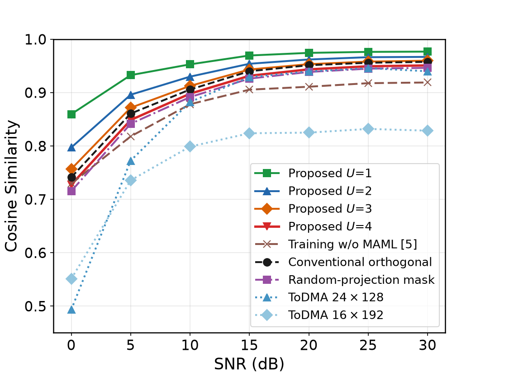
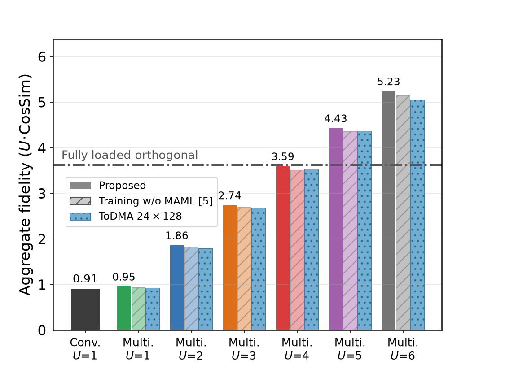
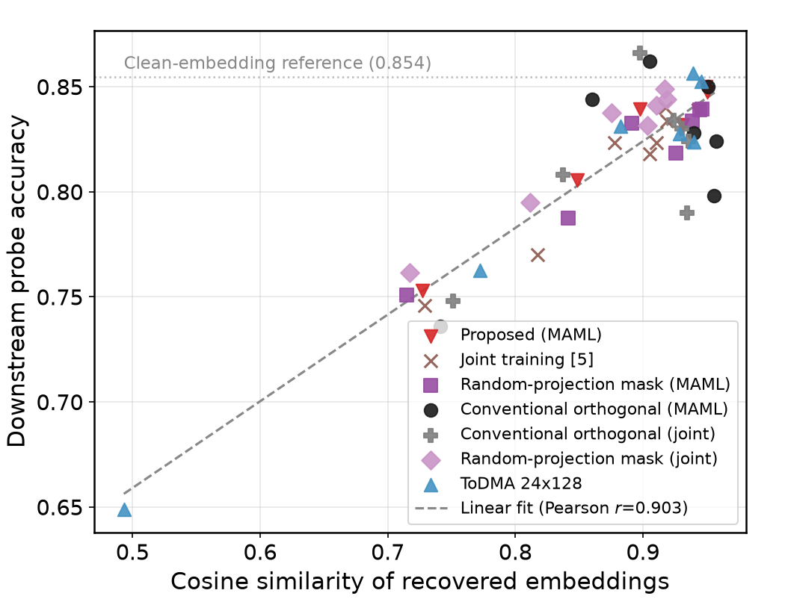

# Semantic Multiplexing Gain in Wireless Systems via Expanded Embeddings: A BERT Case Study

Code, stored results, and supplementary material for the IEEE
Communications Letters submission by Ki-Ho Lee, Hyun-Ho Choi, and
Jung-Ryun Lee.

Multiple users share one expanded embedding block of dimension
`d_s = K * d_b`. Each user's frozen BERT sentence embedding is projected
into the shared space, superimposed through learnable masks, and
demultiplexed by user-wise attention. Every transceiver reported in the
letter, including the conventional orthogonal scheme, is trained with
SNR-aware MAML; the same architecture trained without MAML, as in the
earlier JSAC paper, is included as a prior-art reference and is labelled
"Training w/o MAML [5]" in the figures.

## Files

| File | Purpose |
|---|---|
| `bert_semcom.py` | Shared library: BERT extractor, transceiver model, channel, MAML helpers |
| `cl_experiments.py` | Held-out split, configurations trained without MAML, token-domain (ToDMA) comparison, linear probe, latency |
| `cl_maml_all.py` | SNR-aware MAML training for every reported configuration, including the conventional orthogonal scheme |
| `cl_maml_extra.py` | MAML expansion-factor sweep (K = 1, 2, 8) and DistilBERT replication |
| `cl_todma_load.py` | Evaluates the token-domain scheme at U = 1, 2, 3, 5, 6 for the load sweep of Fig. 3 |
| `replot_cl.py` | Regenerates Figs. 2 and 3 of the letter from the stored JSON results |
| `probe_vs_cosine.py` | Supplementary probe-accuracy-versus-cosine-similarity analysis |
| `fig_cl/*.json`, `fig_cl/*.csv` | Stored raw results behind every figure and every number quoted in the letter |

## Reproducing

Requirements: Python 3.10+, PyTorch (CUDA), `transformers`, `datasets`,
`matplotlib`, `numpy`. AG News loads from the Hugging Face hub
(`fancyzhx/ag_news` fallback included).

```bash
python cl_experiments.py --save-dir fig_cl   # runs without MAML + token-domain comparison (~3 h on a laptop GPU)
python cl_maml_all.py    --save-dir fig_cl   # MAML runs (~9 h)
python cl_maml_extra.py  --save-dir fig_cl   # MAML K sweep + DistilBERT (~6 h)
python cl_todma_load.py  --save-dir fig_cl   # token-domain load sweep (evaluation only)
python replot_cl.py                          # Figs. 2 and 3 from the stored results
python probe_vs_cosine.py                    # supplementary analysis below
```

All experiments fix their random seeds (training seed 42, evaluation
seed 123, token-domain seed 7) and evaluate on a held-out test split of
2,000 AG News sentences disjoint from the 8,000-sentence training pool.
The centering mean, the transceiver parameters, and the linear probe are
fitted on the training pool only. `replot_cl.py` and
`probe_vs_cosine.py` read only the stored results, so every figure is
regenerable without rerunning the experiments.

## Figures of the letter

**Fig. 2 - per-user cosine similarity vs. SNR.** The proposed scheme for
U = 1..4 at K = 4, the conventional orthogonal scheme, the two
matched-budget comparison schemes (random-projection mask and the
token-domain scheme at two slot/codeword splits), and the same
architecture trained without MAML:



**Fig. 3 - aggregate fidelity across load at 10 dB.** Three bars per
load point (proposed, training without MAML, and the token-domain
scheme at 24x128), the conventional single-user block on the left, and
the fully loaded orthogonal aggregate as the dash-dotted reference:



At full load the shared block stays within 1% of the fully loaded
orthogonal aggregate over the same 3072 channel uses (3.59 against
3.62), and under overload it reaches 1.45 times that aggregate at
U = 6.

## Supplementary: probe accuracy vs. cosine similarity

The letter measures semantic fidelity by the cosine similarity of the
recovered embeddings and corroborates it with a downstream perception
metric, namely the AG News topic accuracy of a linear probe fitted on
the training pool and applied to the recovered test embeddings. The
noiseless reference is about 0.854 and the sampling error is about
+/-0.01.

Across 7 schemes x 7 SNRs (49 operating points), probe accuracy tracks
cosine similarity with a Pearson correlation of **r = 0.903**:



Two readings follow. First, the low-SNR advantage of the embedding
schemes over the token-domain scheme appears in both metrics, for
example 0.848 against 0.772 in cosine similarity and 0.805 against
0.762 in accuracy at 5 dB. Second, schemes within about 0.01 of each
other in cosine similarity differ in accuracy by at most 0.023, which
is within about two standard errors of the sampling noise, so the
cosine metric used throughout the letter is consistent with downstream
perception on this task.

## Citation

The letter is under review. Until it appears, please cite this
repository together with the earlier shared-embedding paper:

> K.-H. Lee, H.-H. Choi, and J.-R. Lee, "Transformer-based shared
> embedding for multiple access in semantic communications," *IEEE J.
> Sel. Areas Commun.*, vol. 44, pp. 2622-2637, 2026.

## Revision (IEEE Communications Letters, resubmission of CL2026-2366, October 2026)

Everything behind the revised letter *Load-Agnostic Semantic Multiplexing of BERT
Embeddings in an Expanded Shared Block* lives in `revision/`. The revised
system model has per-user power normalization (every user scales its own masked
signal to the block energy `d_s/U`) and independent Rayleigh fading per user
with phase pre-compensation; the receiver uses a user-specific reverse
projection; training is first-order SNR-aware MAML batched over 64 frames
(150 epochs x 100 steps, meta-batch 4, alpha 5e-4, Adam 1e-3), and every
reported point is evaluated after one inner step on 2,000 held-out frames.

### Layout

| Path | Content |
|---|---|
| `revision/code/rev_lib.py` | shared library: data split and embedding cache, `SharedMux` (proposal) and `OrthoDS` (orthogonal dimension sharing), channel, MAML training, adaptation and evaluation, diagnostics |
| `revision/code/rev_run.py` | trains and evaluates one configuration, writes `data/<name>_s<seed>.json` and a checkpoint |
| `revision/code/rev_queue.sh` | every run of the letter grouped by figure/table: `main`, `main_ortho`, `ortho_s3`, `scale`, `decomp`/`decomp_a`/`decomp_b`, `ablate`/`ablate_b`, `general` |
| `revision/code/rev_cache.py` | builds the embedding caches (`data/emb_*.pt`, not stored here; regenerated from AG News, SST-2, BERT-base, DistilBERT) |
| `revision/code/rev_collect.py` | summarizes all JSON results into `data/rev_summary.csv` and prints the tables |
| `revision/code/rev_replot.py` | regenerates Fig. 2 and Fig. 3 from `data/` only |
| `revision/code/rev_diag.py` | receiver diagnostics of a checkpoint (SIR before/after attention and decoder, random masks at test time) |
| `revision/code/rev_latency.py` | per-frame latency of the stored checkpoints on one device |
| `revision/code/rev_pilot*.sh` | pilot runs that fixed the budget and the receiver design (`data/pilot/`) |
| `revision/data/*.json` | one file per run (76 runs): config, per-SNR per-user CosSim, worst user, probe accuracy, robustness evaluations, mask statistics |
| `revision/data/rev_summary.csv`, `rev_results_table.txt`, `rev_numbers.txt` | aggregated tables and every number quoted in the letter |
| `revision/data/diag/`, `revision/data/rev_latency.json` | diagnostics of the seed-1 full-load model and latency measurements |
| `revision/ckpt/` | seed-1 checkpoints of the proposal at U=4, the load-agnostic model, and ODS at U=4 |
| `revision/fig_cl/` | Fig. 1 (TikZ output), Fig. 2 and Fig. 3 of the revised letter |

### Figure and table map

| Item | Runs | Script |
|---|---|---|
| Fig. 2 | `shared_U4_s{1,2,3}`, `shared_agn_s{1,2,3}`, `ortho_U4_s{1,2,3}`, `shared_U4_randmask_s1`, `shared_U4_joint_s1`, ToDMA from `code/fig_cl/cl_results.json` | `rev_replot.py` |
| Fig. 3 | `shared_U{1..6}_s{1,2,3}`, `shared_agn_s{1,2,3}`, `ortho_U{1..6}_s{1,2,3}`, ToDMA load sweep | `rev_replot.py` |
| Table II | `shared_U4_{randmask,randtx,randboth,noattn,sharedrx}_s1`, `shared_U4_K{1,2,8}_s1`, `shared_U4_K1_randmask_s1`, `shared_U6_{randmask}_s1`, `shared_U4_joint_s1`, `shared_U4_tr{low,high}_s1` | `rev_collect.py` |
| Table III | `robust` blocks of `shared_U4_s1` and `ortho_U4_s1`, `sst2_*`, `distil_*`, `shared_U{8,12,16}_s1`, `ortho_U{8,12,16}_s1` | `rev_collect.py` |

### Reproduction

```bash
cd revision/code
python rev_cache.py                       # embedding caches (needs transformers, datasets)
EXTRA="--per-user-rx" EP=150 BS=64 N_PAR=3 bash rev_queue.sh main
EXTRA="--per-user-rx" EP=150 BS=64 N_PAR=3 bash rev_queue.sh main_ortho   # and scale, decomp, ablate, general
python rev_collect.py ../data && python rev_replot.py
python rev_diag.py ../data/ckpt/shared_U4_s1.pt --snr 10
```

Seeds: training 1, 2, 3; evaluation 123. Devices used: Apple M5 Max (MPS, torch 2.5.1)
and an NVIDIA RTX A4500 (CUDA, torch 2.11); the ToDMA results are the ones of the
original submission (same per-user energy and independent per-user fading).
GPU training is not bit-reproducible, so a re-run reproduces the reported values
within the seed spread reported in the letter (at most 0.0007 in CosSim).
